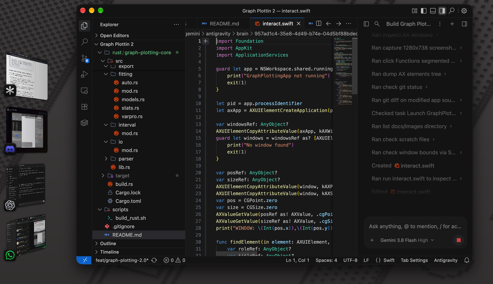

# Architectural Specification: Graph Plotting 2.0

## 1. System Overview and Design Philosophy

Graph Plotting 2.0 is designed as a bifurcated scientific computing platform. It couples a mathematically rigorous, zero-undefined-behavior numerical execution core written in standard Rust with a high-fidelity, hardware-accelerated user interface written in Swift 6 and Metal, running natively on Apple Silicon (`aarch64-apple-darwin`).

```
┌─────────────────────────────────────────────────────────────────────────────┐
│                            SwiftUI Presentation                             │
│       NavigationSplitView · Liquid Glass Overlays · Inspector System        │
└──────────────────────────────────────┬──────────────────────────────────────┘
                                       │ Async Dispatch / @MainActor
┌──────────────────────────────────────▼──────────────────────────────────────┐
│                           Metal 2D Graphics Engine                          │
│     MTKView (120 FPS ProMotion) · Dynamic 1-2-5 MSL Grid · SDF Strokes      │
└──────────────────────────────────────┬──────────────────────────────────────┘
                                       │ In-Process FFI (Zero-IPC)
┌──────────────────────────────────────▼──────────────────────────────────────┐
│                    UniFFI C ABI Layer (XCFramework)                         │
│       RustBuffer Serialization · Memory Safety Contracts · ARC Objects       │
└──────────────────────────────────────┬──────────────────────────────────────┘
                                       │ Monolithic Rust Staticlib
┌──────────────────────────────────────▼──────────────────────────────────────┐
│                         Core Numerical Engine (Rust)                        │
│  Pratt Parser · Bytecode VM · Symbolic Calculus · Moore Interval Arithmetic │
│  VarPro / Levenberg-Marquardt · Parallel Rayon Auto-Fit · SVG/LaTeX Engine   │
└─────────────────────────────────────────────────────────────────────────────┘
```

<p align="center">
  
</p>

The system design enforces four foundational non-negotiables:

1. **Total Isolation of Numerical State**: All mathematical computations—expression tokenization, Pratt parsing, bytecode compilation, interval-arithmetic tessellation, non-linear optimization, Jacobian derivation, and cross-validation—are executed strictly inside the Rust numerical engine (`rust/graph-plotting-core`). No mathematical approximations or heuristic estimations occur within the UI layer.
2. **Deterministic Memory and Concurrency Safety**: The presentation layer is compiled under Swift 6 with strict concurrency checks (`-swift-version 6`). Mutable UI state is strictly isolated to `@MainActor`, while heavy compute routines are offloaded to background threads without shared mutable state. The numerical core relies exclusively on safe Rust, guaranteeing the complete absence of data races, buffer overruns, and use-after-free conditions.
3. **Hardware-Native Pipeline Integration**: Rendering bypasses standard Core Graphics software rasterization. Curves, confidence bands, instanced point primitives, and dynamic anti-aliased cartesian grid coordinate systems are evaluated directly on the GPU via custom Metal Shading Language (MSL) pipelines at 120 FPS.
4. **Zero-IPC In-Process Foreign Function Interface**: Swift and Rust interoperate in-process through a high-performance C ABI bridge managed by `uniffi-rs` (v0.32.2), compiled into a native static framework (`GraphPlottingCoreFFI.xcframework`). Data transfers utilize contiguous packed byte arrays (`Vec<f32>`, `Vec<f64>`) to eliminate marshaling overhead.

---

## 2. Numerical Core Subsystems (Rust)

### 2.1 Lexical Analysis and Pratt Parsing (`src/parser/`)

The parser transforms mathematical expressions $f(x)$ into an Abstract Syntax Tree (AST) using a top-down operator precedence (Pratt) parser capable of resolving non-trivial syntactic ambiguities.

- **Lexer (`lexer.rs`)**:
  - Emits tokens with exact source code byte-spans (`Span { start, end }`) for compiler-grade error diagnostics.
  - Implements **contextual implicit multiplication**:
    $$\text{Tokens: } [2, x] \implies [2, *, x]$$
    $$(x+1)(x-2) \implies (x+1) * (x-2)$$
    $$2\sin(x) \implies 2 * \sin(x)$$
    $$x\cos(x) \implies x * \cos(x)$$
    $$2|x| \implies 2 * |x|$$
  - Resolves unary vs. binary minus disambiguation based on lookbehind state.
  - Recognizes unicode mathematical constants ($\pi$, $\tau$, $e$) and arbitrary free parameters $\theta \in \mathbb{R}^k \setminus \{x\}$.

- **Pratt Parser (`parser.rs`)**:
  - Assigns binding powers $(L_{bp}, R_{bp})$ to ensure correct associativity:
    - Addition/Subtraction: $(1, 2)$ (Left-associative)
    - Multiplication/Division: $(3, 4)$ (Left-associative)
    - Unary Prefix ($-u$): Prefix BP $= 5$
    - Exponentiation ($u^v$): $(7, 6)$ (Right-associative, ensuring $2^{3^4} = 2^{(3^4)}$ and $-x^2 = -(x^2)$)
  - Produces an algebraic AST represented as a recursive enum `Expr`.

- **Symbolic Differentiation Engine (`diff.rs`)**:
  - Computes exact analytical derivatives $f'(x) = \frac{d}{dx}f(x)$ and $f''(x) = \frac{d^2}{dx^2}f(x)$ via structural induction over the AST.
  - Applies standard differentiation rules (Product, Quotient, Chain rules) alongside specific rules for all 25 supported elementary and transcendental functions ($\sin, \cos, \tan, \exp, \ln, \arcsin, \arccos, \arctan, \sinh, \cosh, \tanh, \dots$).
  - Executes canonical algebraic simplification passes:
    $$u + 0 \to u, \quad u \times 1 \to u, \quad u \times 0 \to 0, \quad 0 / u \to 0, \quad u^1 \to u, \quad u^0 \to 1$$
    Constant folding: evaluating closed-form subexpressions over constant nodes at compile time.

- **Stack-Based Bytecode Virtual Machine (`vm.rs`)**:
  - Compiles the AST into a linear instruction vector (`Vec<OpCode>`) held by an opaque UniFFI reference-counted object (`CompiledExpression`).
  - Evaluates expressions during viewport pan/zoom without traversing tree pointers or performing string parsing.
  - VM instruction set includes `PushConst(f64)`, `PushVar`, `PushParam(usize)`, binary arithmetic (`Add`, `Sub`, `Mul`, `Div`, `Pow`), unary math operations (`Sin`, `Cos`, `Exp`, `Ln`, `Abs`, `Sqrt`, `Gamma`), and stack control.
  - Operates on a fixed pre-allocated evaluation stack, achieving throughput exceeding $1.5 \times 10^7$ evaluations per second per core.

### 2.2 Topological Interval Tessellation (`src/interval/`)

Standard linear sampling of functions over cartesian grids fails catastrophically near vertical asymptotes (e.g., $f(x) = \tan x$ or $f(x) = \frac{1}{x}$), generating spurious vertical connection lines across discontinuities.

Graph Plotting 2.0 solves this via rigorous Moore interval arithmetic coupled with an adaptive spatial subdivision algorithm:
- Every subinterval $[x_k, x_{k+1}]$ is evaluated as an interval $X = [\underline{x}, \overline{x}]$.
- Arithmetic operators evaluate bound extensions:
  $$[a, b] + [c, d] = [a + c, b + d]$$
  $$[a, b] \times [c, d] = [\min(ac, ad, bc, bd), \max(ac, ad, bc, bd)]$$
  $$[a, b] / [c, d] = [a, b] \times [1/d, 1/c] \quad (0 \notin [c, d])$$
- If $0 \in [c, d]$ during division, or the argument of $\ln(X)$ intersects non-positive real space, an interval singularity flag is triggered.
- Subintervals with valid, bounded outputs and bounded second derivative variation are tessellated as continuous polyline strips (`PolylineStrip`).
- Subintervals crossing essential singularities or exceeding the viewport's vertical clipping bounds ($[y_{\min}, y_{\max}]$) terminate the active strip and initiate a fresh primitive strip on the opposite side of the pole, guaranteeing mathematical fidelity without vertical jump artifacts.

### 2.3 Empirical Regression Engine (`src/fitting/`)

- **Variable Projection (VarPro)**: Implements the Golub-Pereyra reduction theorem. For separable nonlinear models:
  $$y = \sum_{j=1}^p c_j \phi_j(x; \boldsymbol{\beta})$$
  The linear parameters $\mathbf{c} \in \mathbb{R}^p$ are solved analytically at each step using Singular Value Decomposition (SVD) of the model design matrix $\Phi(\boldsymbol{\beta})$, reducing the parameter dimensionality explored by the Levenberg-Marquardt optimizer to only the non-linear subspace $\boldsymbol{\beta}$.
- **Initial Estimation via Lomb-Scargle Spectral Analysis**: For periodic models ($\sin$, $\cos$), non-uniform discrete Fourier analysis (Lomb-Scargle periodogram) identifies the dominant fundamental frequency $\omega_0$ prior to non-linear refinement, avoiding convergence to local harmonic traps.
- **Robust Huber Iteratively Reweighted Least Squares (IRLS)**: Provides optional outlier rejection using Huber's M-estimator loss function.

---

## 3. Interoperability and ABI Bridge (`GraphPlottingCoreFFI`)

The foreign function interface bridge connects the Rust dynamic core to the Swift runtime without inter-process communication (IPC) overhead or serialization bottlenecks.

```
                    ┌─────────────────────────┐
                    │     Swift Call Site     │
                    └────────────┬────────────┘
                                 │
                     Direct C Function Call
                                 │
                    ┌────────────▼────────────┐
                    │  graph_plotting_coreFFI │
                    │      Header / C ABI     │
                    └────────────┬────────────┘
                                 │
                   Foreign Rust Function Entry
                                 │
                    ┌────────────▼────────────┐
                    │  Rust staticlib (.a)    │
                    │  Core Numerical Engine  │
                    └─────────────────────────┘
```

### 3.1 Memory Layout and Alignment
- All data exchanged across the boundary conforms strictly to C ABI representations (`#[repr(C)]`).
- Fixed structures (`CoreDataPoint`, `CoreRootResult`, `CoreExtremumResult`, `CoreIntegralResult`) are passed by value on the CPU register stack.
- Tessellated geometry (`PolylineStrip`) transmits vertices as contiguous packed 32-bit floating-point arrays (`Vec<f32>` containing $[x_0, y_0, x_1, y_1, \dots]$), matching Metal's `MTLBuffer` vertex layout with zero element-by-element transposition.

### 3.2 Threading Contract
- Rust functions invoked from Swift are re-entrant, stateless, and thread-safe (`Send + Sync`).
- Auto-fit model parallelization is managed internally via a Rayon thread pool that dynamically sizes worker threads to available Apple Silicon performance and efficiency cores.

---

## 4. Hardware-Accelerated Rendering Pipeline (Metal)

Rendering is implemented through a custom Metal 3.0 graphics pipeline coordinated by `GraphRenderer` (`MTKViewDelegate`).

### 4.1 Vertex and Fragment Pipelines
The pipeline establishes four distinct render states:
1. **Dynamic Grid Pipeline (`grid_vertex`, `grid_fragment`)**:
   - Renders a fullscreen bounding quad ($[-1, 1]^2$).
   - The fragment shader evaluates a continuous screen-space signed distance field (SDF) of the major and minor grid lines based on dynamic $1\text{–}2\text{–}5 \times 10^k$ decade scaling.
   - Computes analytical anti-aliasing via derivative scaling:
     $$\Delta_{\text{pixel}} = \frac{v_{\max} - v_{\min}}{\text{screen\_size}}$$
     Smooth-stepped line transitions eliminate aliasing artifacts during rapid scaling operations.
2. **Curve Stroke Pipeline (`curve_vertex`, `curve_fragment`)**:
   - Consumes tessellated world-space vertex buffers directly from the Rust core.
   - Transforms world coordinates $(x, y) \in \mathbb{R}^2$ to Normalized Device Coordinates (NDC) in the vertex shader.
   - Draws primitives as continuous `lineStrip` elements with hardware alpha blending.
3. **Area Fill Pipeline (`area_vertex`, `area_fragment`)**:
   - Rasterizes confidence intervals and definite integrals using interleaved triangle strips connecting lower and upper bounds:
     $$\text{Vertices: } [u_0, l_0, u_1, l_1, u_2, l_2, \dots]$$
   - Applies smooth semi-transparent blending (`sourceAlpha` / `oneMinusSourceAlpha`).
4. **Instanced Point Marker Pipeline (`point_vertex`, `point_fragment`)**:
   - Scatter plot data points are rendered via hardware instancing.
   - A single unit quad is instanced $N$ times with an instance buffer containing world coordinates.
   - The fragment shader computes an exact circle SDF with an analytical anti-aliased border ring:
     $$d = \|\mathbf{p}_{\text{local}}\| - r$$
     Pixels where $d > 0$ are discarded via `discard_fragment()`.

<p align="center">
  
</p>

---

## 5. Concurrency and State Architecture (Swift 6)

The application conforms to Swift 6 strict concurrency (`SWIFT_STRICT_CONCURRENCY=complete`).

```
                    ┌─────────────────────────┐
                    │       User Action       │
                    │   (Add Point / Fit)     │
                    └────────────┬────────────┘
                                 │
                    ┌────────────▼────────────┐
                    │    @MainActor State     │
                    │    AppState.fitData()   │
                    └────────────┬────────────┘
                                 │
             Extract Sendable Data / Detach Background Thread
                                 │
                    ┌────────────▼────────────┐
                    │  Task.detached Context  │
                    │ GraphPlottingCore.fit() │
                    └────────────┬────────────┘
                                 │
                     Await Non-Blocking Result
                                 │
                    ┌────────────▼────────────┐
                    │    @MainActor State     │
                    │   Update fitResults     │
                    │    Trigger Redraw       │
                    └─────────────────────────┘
```

- **Actor Isolation**:
  - `AppState` is decorated with `@MainActor`. All observable properties bound to SwiftUI views are modified exclusively on the main dispatch queue.
  - Background computations (such as Auto Fit racing 15 models or evaluating definite integrals over fine meshes) extract immutable `Sendable` value types (`[CoreDataPoint]`, `FitType`, `Double`) and execute in detached cooperative tasks (`Task.detached`).
  - Upon completion, computed results (`[CoreFitResult]`) flow back into the main actor isolation context, triggering minimal SwiftUI re-renders and an event-driven `setNeedsDisplay` notification on the `MTKView`.
- **Power and Thermal Optimization**:
  - `MTKView.isPaused = true` and `MTKView.enableSetNeedsDisplay = true`.
  - The GPU remains completely dormant (0% GPU utilization) when the viewport and data are static.
  - Redraws are dispatched exclusively upon user interaction (pan, pinch-to-zoom, window resize) or when computation tasks publish new geometry.
